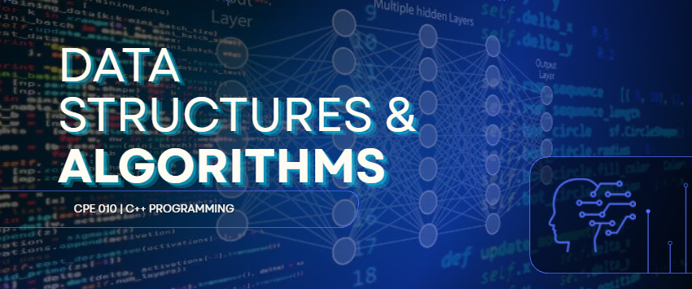

  

  

### CPE 010 | C++ Programming Laboratory Repository

  
  
  

---

## 📌 OVERVIEW

This repository contains hands-on laboratory activities, code implementations, and problem sets completed for **Data Structures and Algorithms (CPE 010)**. It serves as a collection of programming exercises and practical applications that demonstrate the concepts, techniques, and algorithms learned throughout the course using C++.

### 📗 MIDTERMS (Hands-on Activities 6–9)

| Hands-on No. | Title |
|---|---|
| **6.1** | Searching Techniques |
| **7.1** | Sorting Algorithms Part 1 |
| **8.1** | Sorting Algorithms Part 2 |
| **9.1** | Tree ADT |

  

