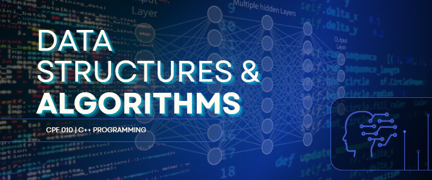

<p align="center">
  
</p>

<p align="center">
  
</p>

### CPE 010 | C++ Programming Laboratory Repository

<p align="center">
  
  
  
</p>

---

## 📌 OVERVIEW

This repository contains hands-on laboratory activities, code implementations, and problem sets completed for **Data Structures and Algorithms (CPE 010)**. It serves as a collection of programming exercises and practical applications that demonstrate the concepts, techniques, and algorithms learned throughout the course using C++.

## 👩‍💻 ABOUT

| **Information** | **Details** |
|:---|:---|
| **Student** | Niña Denise M. Santiago |
| **Organization** | Technological Institute of the Philippines |
| **Year Level** | 2nd Year |
| **Course** | CPE 010 – Data Structures and Algorithms |
| **Programming Language** | C++ |

---

## 📖 COURSE DESCRIPTION

This course focuses on solving computational problems that manipulate collected data, studying a core set of data abstractions, data structures, and algorithms that provide a foundation for writing efficient programs.

The course covers theoretical topics in algorithmic efficiency and complexity, along with abstract data types such as graphs, networks, trees (including binary and multi-way trees), heaps, stacks, and priority queues. It also introduces searching techniques, including hashing, trees, and external search trees (B-trees), as well as fundamental sorting algorithms and external sorting.

By the end of the course, students are expected to design algorithms for different data structures and apply these concepts in developing effective programs or software applications that solve engineering-related problems using C++.

---

## 🎯 COURSE OUTCOMES

Upon completion of this course, students should be able to:

1. **Apply Fundamental Data Structures**  
   Apply fundamental data structures and techniques to solve engineering-related problems through algorithm design.

2. **Analyze Algorithm Efficiency**  
   Design efficient algorithms and analyze their complexity.

3. **Implement Data Structures and Algorithms**  
   Build efficient algorithms based on selected data structures using good programming practices in C++.

---

## 📂 REPOSITORY STRUCTURE

The repository is organized into three academic periods to make the activities and programming implementations easier to navigate.

```text
📦 CPE-010-DATA-STRUCTURES-AND-ALGORITHMS
 ┣ 📂 Preliminaries
 ┃ ┗ 📄 Laboratory Activities Source Codes
 ┣ 📂 Midterms
 ┃ ┗ 📄 Laboratory Activities Source Codes
 ┣ 📂 Finals
 ┃ ┗ 📄 Laboratory Activities Source Codes
 ┗ 📄 README.md
```

---

## 🛠️ TECHNOLOGIES USED

| Technology | Purpose |
|:---|:---|
| **C++** | Primary programming language |
| **Visual Studio Code** | Code editor and development environment |
| **Git** | Version control |
| **GitHub** | Source code repository and project documentation |

---

<p align="center">
  
</p>
